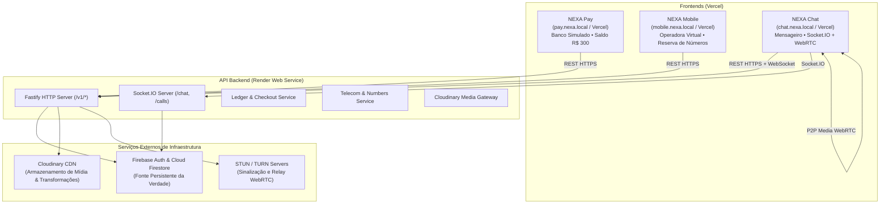
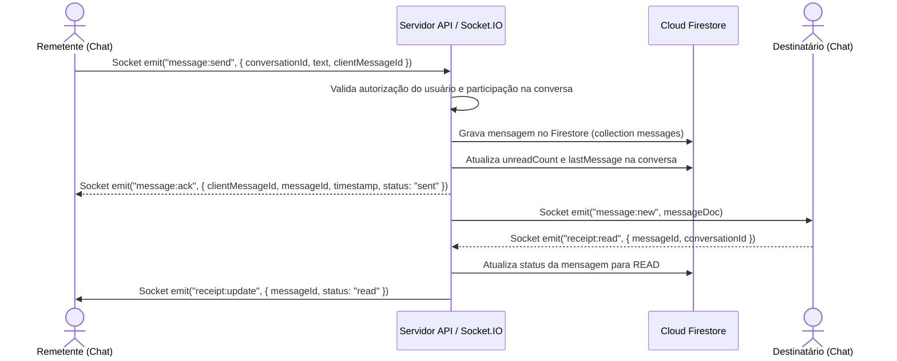
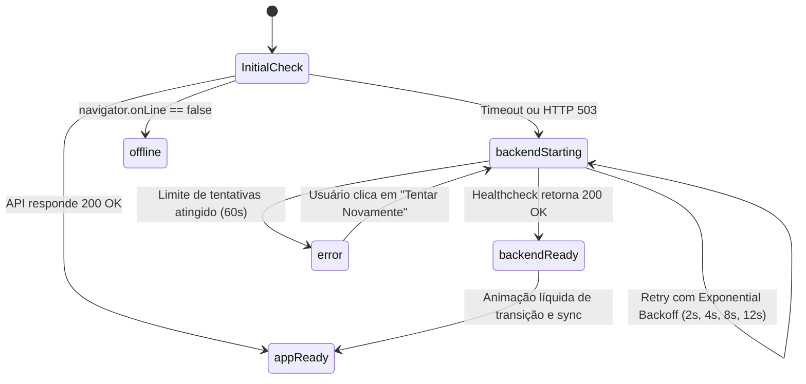

# ARQUITETURA DO SISTEMA — NEXA ECOSYSTEM

Este documento define a topologia, as fronteiras de responsabilidade, os fluxos de dados e as garantias de consistência do ecossistema NEXA.

---

## 1. Visão Geral e Topologia

O ecossistema NEXA é composto por três aplicações web front-end independentes e uma API backend unificada que orquestra persistência, tempo real e autorização:



### 1.1 Separação Rígida de Responsabilidades
1. **GitHub:** Repositório monorepo e CI/CD. Não hospeda serviços em execução.
2. **Vercel:** Hospeda os 3 frontends como Single Page Applications (Vite + React + TS). Não hospeda conexões persistentes de WebSocket.
3. **Render:** Hospeda o serviço persistente Node.js (`apps/api`) em Web Service Linux, escutando em `0.0.0.0:${PORT}`.
4. **Cloud Firestore:** Fonte autoritativa persistente de dados. O cliente web **não possui autorização para escrita direta** em documentos de carteiras, compras, números ou mensagens.
5. **Cloudinary:** Armazenamento exclusivo de arquivos binários (imagens, vídeos, áudios e documentos). Nenhum arquivo fica no disco efêmero do Render.

---

## 2. Estrutura do Monorepo

O monorepo utiliza `npm workspaces` nativo para garantir compatibilidade e reprodutibilidade:

```text
nexa-ecosystem/
├── apps/
│   ├── pay/                  # Frontend Vite + React: Banco digital demo
│   ├── mobile/               # Frontend Vite + React: Operadora e vitrine cinematográfica
│   ├── chat/                 # Frontend Vite + React: Mensageiro instantâneo e chamadas
│   └── api/                  # Backend Fastify + TypeScript + Socket.IO
├── packages/
│   ├── design-tokens/        # Tokens Liquid Glass, temas, cores e curvas spring
│   ├── ui/                   # Biblioteca compartilhada de componentes glass
│   ├── types/                # Definições de tipos TypeScript de domínio
│   ├── validation/           # Schemas Zod universais para cliente e servidor
│   ├── sdk/                  # Cliente HTTP e Socket.IO tipado com tratamento de cold start
│   ├── firebase-client/      # Configuração modular do Firebase Client SDK
│   ├── utils/                # Funções utilitárias (formatação BRL, datas, máscaras)
│   └── config/               # Configurações compartilhadas (ESLint, TSConfig)
├── firestore.rules           # Regras de segurança Firestore deny-by-default
├── firestore.indexes.json    # Índices compostos necessários
├── firebase.json             # Configuração para emuladores locais
└── .github/workflows/ci.yml  # Pipeline de integração contínua
```

---

## 3. Fluxo de Compra e Pagamento Cross-Origin

Como os três frontends residem em domínios ou subdomínios diferentes, **não há compartilhamento de cookies ou localStorage**. Toda a comunicação entre Mobile e Pay é mediada pelo backend com tickets criptograficamente opacos e de uso único:

```mermaid
sequenceDiagram
    autonumber
    actor User as Usuário
    participant Mobile as NEXA Mobile (Frontend)
    participant API as NEXA API (Fastify)
    participant Pay as NEXA Pay (Frontend)
    participant DB as Cloud Firestore

    User->>Mobile: Seleciona número virtual e clica em Comprar
    Mobile->>API: POST /v1/mobile/orders (JWT Google Auth, numberId, idempotencyKey)
    API->>DB: Verifica disponibilidade do número
    API->>DB: Cria Pedido (state: RESERVED, expiresAt: +15min)
    API->>DB: Gera checkoutTicket opaco com hash no DB
    API-->>Mobile: Retorna orderId e checkoutTicket
    Mobile->>Pay: Redireciona com ?ticket=xyz
    Pay->>API: GET /v1/pay/checkouts/xyz (Sessão Anônima)
    API-->>Pay: Retorna resumo público seguro (valor, número reservado, expiração)
    User->>Pay: Clica em "Confirmar Pagamento Simulado"
    Pay->>API: POST /v1/pay/checkouts/xyz/confirm (JWT Anônimo, idempotencyKey)
    
    rect rgb(20, 30, 45)
        Note over API,DB: Transação Atômica Firestore
        API->>DB: Valida saldo da carteira demo (mínimo 2990 centavos)
        API->>DB: Debita saldo e cria entrada imutável no walletLedger
        API->>DB: Altera status do pedido para PAID
        API->>DB: Vincula número virtual ao uid do comprador com status ACTIVE
        API->>DB: Invalida checkoutTicket
    end

    API-->>Pay: Confirmação e dados do Comprovante Simulado
    Pay->>User: Exibe comprovante com carimbo SIMULADO
    Pay->>Mobile: Redireciona de volta com ?orderId=abc
    Mobile->>API: GET /v1/mobile/orders/abc (JWT Google Auth)
    API-->>Mobile: Retorna status PAID e número ativo
    Mobile->>User: Apresenta linha ativada na área "Meus Números"
```



### 3.1 Garantias de Integridade Financeira Fictícia
- **Valores em centavos inteiros:** Nenhum valor em ponto flutuante é admitido nas APIs ou banco. R$ 300,00 = `30000` centavos.
- **Idempotency Keys:** Cada operação de criação de checkout ou pagamento exige um cabeçalho ou payload `Idempotency-Key` (UUIDv4). Repetições com a mesma chave devolvem o resultado original sem re-débito.
- **Transações Atômicas:** Se a vinculação do número falhar, a transação reverte o débito da carteira. Caso ocorra erro de sistema intermediário, o pedido assume o estado `PAID_PENDING_ACTIVATION` para reconciliação automática pelo worker.

---

## 4. Arquitetura de Mensageria e Presença em Tempo Real

Para evitar perda de mensagens e inconsistências entre clientes, o sistema adota o padrão **Single Authoritative Write Path via Servidor**:



### 4.1 Resiliência e Reconexão
- Ao desconectar e reconectar, o cliente emite `sync:request` com o `lastTimestamp` ou cursor da última mensagem armazenada no cache local.
- O servidor busca mensagens persistidas no Firestore a partir desse cursor, garantindo entrega integral mesmo se o Socket.IO esteve fora do ar durante um auto-restart do Render.

---

## 5. WebRTC 1:1 — Chamadas de Áudio e Vídeo

O tráfego de mídia de áudio e vídeo é estritamente **Peer-to-Peer (P2P)** utilizando WebRTC, enquanto o Socket.IO atua exclusivamente como barramento de sinalização:

1. **Convite e Validação:** O usuário `A` dispara `call:invite` para o usuário `B`. O servidor verifica se `B` não bloqueou `A` e se ambos possuem contas válidas.
2. **Sinalização:**
   - Troca de SDP: `call:offer` e `call:answer`.
   - Troca de candidatos de rede: `call:ice`.
3. **Mídia P2P:** A conexão de áudio/vídeo trafega diretamente entre os navegadores através do `RTCPeerConnection`.
4. **STUN/TURN:** Servidores STUN públicos (Google STUN) são usados para descoberta de IP reflexivo. Servidores TURN temporários com credenciais assinadas são fornecidos para contornar NATs simétricos.
5. **Privacidade:** Nenhuma gravação de áudio ou vídeo é executada ou armazenada no servidor.

---

## 6. Tratamento de Cold Start no Render (Máquina de Estados)

Como o Render suspende serviços gratuitos após inatividade, o frontend implementa uma máquina de estados visual que evita travamentos ou interfaces quebradas:



Enquanto `backendStarting` está ativo:
- Uma tela Liquid Glass premium com branding NEXA e anel de luz em refração contínua é renderizada.
- Não são apresentadas porcentagens falsas; exibe-se texto honesto: *"Conectando ao servidor... Seus dados permanecem seguros."*
- Ao restabelecer a conexão, a tela dissolve suavemente e os sockets sincronizam o estado pendente.
